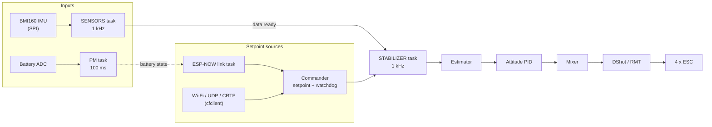

# Architecture

How the firmware is put together: what starts when, which tasks run, how a stick movement becomes a motor
command, and what protects you when something goes wrong.

## The big picture

## Boot sequence

`app_main` initialises NVS, identifies the platform, and starts the **system task**. That task walks one
table, `systemModules[]` in [`system.c`](../../components/core/crazyflie/modules/src/system.c), calling each
module's init in order and then every module's self-test.

| # | Module | Notes |
|---|---|---|
| 1 | led | red LED on until the system has started |
| 2 | wifi | soft AP and UDP server |
| 3 | espnow | ESP-NOW link, then a 500 ms pause |
| 4 | system | creates the lock other tasks wait on in `systemWaitStart()` |
| 5-9 | wifilink, sysload, crtp, console, worker | early on so that debug output works from here |
| 10 | ledseq | LED sequences, essential |
| 11 | adc, pm | battery measurement and power management, essential |
| 12 | buzzer | essential, only if enabled |
| 13 | comm | CRTP link, log and param services |
| 14 | commander | setpoint holder and the high-level planner |
| 15 | stabilizer | sensors, estimator, controller, mixer, motors |
| 16-17 | sound, mem | |
| 18 | assert | checks the previous run did not end in an assert |

**Self-test.** Every failing test is reported by name. If an *essential* module (worker, ledseq, pm, buzzer)
fails, the system does not start and lights the system LED. Any other failure leaves the drone waiting, and
it can be started anyway from the client. Otherwise `systemStart()` releases every task that is blocked in
`systemWaitStart()`: sensors, stabilizer, link tasks.

**Adding a module:** add one line to `systemModules[]`. A module without `init` is only tested, one without
`test` is only initialised.

## Tasks

FreeRTOS, 1 kHz tick, higher number is higher priority. Stack sizes are multiples of `BASE_STACK_SIZE`
(1024 bytes on the ESP32). **No task is pinned to a core**, the scheduler places them, see
[code review](code-review.md#dual-core-and-timing).

| Task | Pri | Stack | Role |
|---|---|---|---|
| STABILIZER | 7 | 5x | the control loop |
| SENSORS | 6 | 5x | reads the IMU, signals the stabilizer |
| ZRANGER (VL53L0X) | 5 | 2x | range finder, if enabled |
| KALMAN | 4 | 3x | **not started** (see below) |
| ESPNOWLINK | 3 | 4x | decodes control frames, arming, failsafe, status downlink |
| CMDHL | 3 | 2x | high-level trajectory planner |
| DSHOT-KA | 2 | 2x | keeps the ESCs fed when the stabilizer is not running |
| WIFILINK / UDP_RX / UDP_TX | 2 | 4x | UDP side of the CRTP link |
| CRTP-RX / CRTP-TX | 2 | 3x | CRTP routing |
| LOG / PARAM / MEM | 2 | 3x / 2x / 2x | CRTP log, parameter and memory services |
| SYSTEM | 1 | 6x | init, then the worker loop |
| PWRMGNT | 1 | 4x | battery measurement |
| LEDSEQCMD | 1 | 2x | LED sequences |

The FreeRTOS timer service task (priority 1, from ESP-IDF) also matters: the 1 kHz sensor tick is currently
a software timer running there.

## The control path

1. **SENSORS** wakes on a 1 ms software timer, reads accelerometer and gyro over SPI, removes the gyro bias,
   filters, and gives a semaphore.
2. **STABILIZER** wakes on that semaphore and runs, every millisecond:
   estimator (complementary filter) -> commander setpoint -> attitude and rate PID controllers (both run
   at 500 Hz) -> mixer -> motor output.
3. The **mixer** adds thrust, roll, pitch and yaw per motor and clamps to `[48, MOTOR_THRUST_MAX]`.
4. **DShot** frames go out through the RMT peripheral, one per motor, every loop.

Rates: main loop 1 kHz, attitude 500 Hz, position 100 Hz.

### Estimators

| Estimator | State |
|---|---|
| Complementary (Mahony) | default and only one running |
| Kalman | code is present but its task is **not started** in `systemModules[]`. Selecting it falls back to the complementary estimator with a warning. |

## Setpoint sources and the commander

Two sources can fly the drone, both end at `commanderSetSetpoint()`:

* **ESP-NOW link** ([details](espnow-link.md)): `espnow_link.c` decodes the control frame and feeds the same
  roll/pitch/yaw/thrust decoder that CRTP uses, so thrust locking and flight modes behave identically.
* **Wi-Fi / CRTP** (cfclient or your own dashboard): UDP port 2390 into `wifilink`, `crtp`, then the commander.

The **commander** keeps the latest setpoint and applies two watchdogs (both configurable under
*Failsafe & Arming*):

| No setpoint for | Behaviour |
|---|---|
| 500 ms (default) | roll and pitch forced to zero, last thrust kept |
| 2000 ms (default) | null setpoint, thrust drops to zero |

The ESP-NOW link has its own, faster, failsafe (250 ms), see the next section.

## Safety model

| Layer | What it does |
|---|---|
| **Arming** | Motors only run while armed. The ESP-NOW link boots disarmed and arms on a 0 -> 1 edge of the ARM flag with thrust at zero. |
| **Kill** | The KILL flag stops the motors immediately and latches until ARM and KILL are both released. |
| **Link failsafe** | 250 ms without a valid frame: level setpoint, zero thrust, disarm. |
| **Commander watchdog** | Covers the CRTP path, see above. |
| **Tumble detection** | `sitaw` stops the motors if the vehicle is upside down while flying. The link does not release a stop it did not set. |
| **Thrust ceiling** | One value, `MOTOR_THRUST_MAX`, limits the commander and the mixer. |
| **DShot keepalive** | A task sends minimum throttle if no frame went out for 10 ms, so a stalled stabilizer cuts the motors. |
| **Self-test** | A failed essential module blocks the start. |

Not covered yet: a hardware watchdog on the stabilizer, battery-driven landing, and a DShot disarm
(command 0) on kill. Today a kill sends minimum throttle, the ESCs stay armed at 0 % throttle.

## Logging and parameters

CRTP log blocks are read by timers and sent over UDP to the dashboard, at most 100 Hz per block, 26 bytes
per packet. Parameters are exposed the same way and **are not stored**, they reset at reboot. The
[code review](code-review.md#logging) lists what to change.

## Source map

| Directory | Contents |
|---|---|
| `components/core/crazyflie/modules/src` | stabilizer, controllers, estimators, commander, CRTP, log, param, system |
| `components/core/crazyflie/hal/src` | sensors (`sensors_flyingfree_v01.c`), power management, Wi-Fi link, ESP-NOW link, LED sequences, buzzer |
| `components/core/crazyflie/utils` | filters, PID helpers, rate supervisor |
| `components/drivers/general` | motors (DShot and brushed), LEDs, buzzer, ADC, Wi-Fi |
| `components/drivers/i2c_spi_devices` | BMI160 |
| `components/drivers/i2c_devices` | QMC5883L, BMP280, VL53L0X/L1X, EEPROM stub |
| `components/drivers/i2c_bus`, `spi_bus` | bus layers |
| `components/platform` | board identification (`FF01`) and the compatibility header `stm32_legacy.h` |
