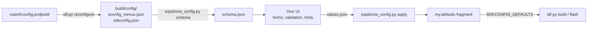

# Configuration

All build-time settings live in one place, **`idf.py menuconfig` -> ESPDrone Config**, grouped the way a
flight-controller configurator groups them. The complete list with defaults and ranges is in the
[configuration reference](configuration-reference.md).

## The menu

| Group | What you set there |
|---|---|
| **Board** | Wiring of the board: I2C, SPI, LED, buzzer and battery-sense pins. Defaults match FlyingFree V1.0. |
| **Sensors** | Which optional sensors are fitted (magnetometer, barometer, range finder), whether the board is mounted upside down, pitch and roll trim. |
| **Motors & ESC** | Brushless or brushed, DShot150/300/600, motor output pins, the **maximum motor command**. |
| **Power** | 3S or 4S, low-battery and critical-battery voltage per cell. |
| **Receiver & Link** | Wi-Fi access point (SSID, password, channel) and the ESP-NOW control link (peer MAC, encryption, timeout, scaling). |
| **Failsafe & Arming** | How long without a setpoint before the drone levels out, and before it cuts the thrust. |
| **Flight control** | Position-hold options and the **PID gains**. |
| **Debug & logging** | Where debug messages go. |
| **System** | Task stack unit. |

The three things people change most:

| Want to... | Setting |
|---|---|
| Limit throttle while testing | *Motors & ESC* -> `MOTOR_THRUST_MAX` (48 = 0 %, 2047 = 100 %, default 1000) |
| Tune the attitude response | *Flight control* -> *PID gains* (stored x1000, `75000` = 75.0) |
| Allow only your transmitter | *Receiver & Link* -> *ESP-NOW* -> `ESPNOW_CTRL_PEER_MAC` (+ encryption) |

## Ways to apply a configuration

| Method | When |
|---|---|
| `idf.py menuconfig` | interactive, writes `sdkconfig` |
| Edit `sdkconfig.defaults` | settings every build of the project should start from |
| A **profile** in `profiles/` | an optional layer, selected per build |
| A generated fragment | produced by a tool or UI, see [below](#building-a-configurator-ui) |

Layers are applied in order, later ones win:

```bash
idf.py -D "SDKCONFIG_DEFAULTS=sdkconfig.defaults;profiles/bench.defaults;my.defaults" reconfigure build
```

> Defaults are only read when `sdkconfig` does not exist. After changing the list, delete `sdkconfig`.

### Profiles

| File | Purpose |
|---|---|
| [`profiles/bench.defaults`](../../profiles/bench.defaults) | First power-up and props-off tests: motor ceiling 300, boots disarmed |
| [`profiles/sysview.defaults`](../../profiles/sysview.defaults) | SEGGER SystemView over JTAG for debug output and traces |

### Compile time versus run time

Kconfig values are fixed in the image: changing one means a rebuild and a flash. The PID gains can also be
changed **live** through the CRTP parameters (cfclient or your dashboard), but those changes are lost at
reboot because parameters are not persisted yet. A persistent settings store is the first step towards a
real configurator, see [code review](code-review.md#configuration).

## Building a configurator UI

For a Betaflight-style tool, [`tools/config/espdrone_config.py`](../../tools/config/espdrone_config.py)
turns the Kconfig into data a UI can render, and turns the user's choices back into a build.



### 1. Export the schema

```bash
idf.py reconfigure
tools/config/espdrone_config.py schema -o schema.json
```

The schema is a tree of groups. Every field carries what a form needs:

```json
{
  "name": "MOTOR_THRUST_MAX",
  "type": "int",
  "title": "Maximum motor command (DShot units, 48 = 0 %, 2047 = 100 %)",
  "help": "Upper limit of the commander thrust and of every motor output after mixing. ...",
  "range": [100, 2047],
  "value": 1000,
  "depends_on": "BRUSHLESS",
  "visible": true
}
```

| Field | Meaning |
|---|---|
| `type` | `bool`, `int`, `hex`, `string`, `choice`, or `menu` for a group |
| `value` | current value (the default for a fresh configuration) |
| `range` | `[min, max]` for numbers |
| `choices` | for a `choice`: list of `{name, title, visible}`, `value` is the selected member |
| `depends_on` | the raw Kconfig expression, `visible` is its result for the current values |
| `items` | child fields. Kconfig nests every setting that depends on the previous one beneath it, show these indented or only when the parent is on |

`visible` is evaluated once. When the user changes a value in the UI, re-evaluate `depends_on` yourself
(`&&`, `||`, `!`, `=`, `!=` and symbol names), or re-run `schema` after applying.

### 2. Apply the user's choices

```json
{
  "BATTERY_4S": true,
  "MOTOR_THRUST_MAX": 600,
  "PID_ROLL_RATE_KP": 80000,
  "ESPNOW_CTRL_PEER_MAC": "aa:bb:cc:dd:ee:ff"
}
```

```bash
tools/config/espdrone_config.py apply values.json -o my.defaults
```

`apply` rejects unknown names, wrong types and out-of-range numbers (exit code 1, one line per problem), so
a UI can show the messages as they are. For a choice, either set the choice
(`{"BATTERY": "BATTERY_4S"}`) or set one member to `true`. Then build with the fragment as an extra layer.

### Checked

Against a real configure: all 92 symbols are exported, visibility follows the dependencies (the
encryption keys are hidden while encryption is off, the PWM protocol while the motors are brushless),
bad values are rejected, and a generated fragment gives the expected configuration when ESP-IDF reads it
back. The tool is not tied to any UI.

## Adding a setting

1. Add a `config` entry in `main/Kconfig.projbuild`, in the group where a user would look for it. Give it a
   title, a range for numbers and a help text, they become the UI labels and hints. Name every `choice`.
2. Use it in code as `CONFIG_<NAME>`. Numbers with a fraction are stored scaled (see the PID gains).
3. Regenerate the reference:

```bash
idf.py reconfigure
tools/config/espdrone_config.py schema -o /tmp/schema.json
tools/config/make_reference.py /tmp/schema.json > docs/handbook/configuration-reference.md
```
