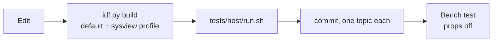

# Development

How to work on the code, how it is checked, and what changed in this fork.

## Workflow

* Work on `main` (or a branch from it). `master` is the untouched upstream ESP-Drone. Use `git switch main`,
  `git checkout main` is ambiguous because `main/` is also a directory.
* Commit small, one topic per commit, with the reason in the message. Remove code only after the state it
  was in has been committed.
* Some files use CRLF line endings (`pm_esplane.h`, `pm_esplane.c`). Keep them when editing.

## Checks

| Check | Command | Needs |
|---|---|---|
| Firmware builds | `idf.py build` | ESP-IDF 4.4.8 |
| Build with SystemView | `idf.py -D "SDKCONFIG_DEFAULTS=sdkconfig.defaults;profiles/sysview.defaults" reconfigure build` | same |
| Transmitter example builds | `cd examples/espnow_transmitter && idf.py set-target esp32 build` | same |
| Unit tests | `tests/host/run.sh` | gcc only |
| Kconfig schema still exports | `idf.py reconfigure && tools/config/espdrone_config.py schema -o /dev/null` | same |

CI (`.gitlab-ci.yml`) builds the ESP32 target and the SystemView profile. It does not run the unit tests yet.

### Host tests

`tests/host/` compiles real firmware source files against small stub headers (`tests/host/stubs/`) and runs
them under AddressSanitizer and UBSan. Today it covers the ESP-NOW link state machine. Modules that are
pure logic (PID, mixer, filters, the link) are good candidates for more.

### Keeping a clean build

A clean build prints 10 distinct compiler warnings (in `stabilizer.c`, `cfassert.c`, `pm_esplane.c`,
`sensors_flyingfree_v01.c` and `motors_brushless.h`), none in the ESP-NOW code. Fix a warning when you
touch the file, and do not add new ones.

## What changed in this fork

Everything since the first FlyingFree commits, in order, all on `refactor/espnow-link-and-cleanup`
(156 files, +2114 / -20054 lines):

| Area | Change |
|---|---|
| **Safety** | Emergency stop is no longer cleared by every setpoint. Motor function table fixed (brushed and brushless pointers were swapped). Battery thresholds are now per cell, so low-battery works on 3S/4S. |
| **ESP-NOW link** | New native link with sequence numbers, CRC, arming, kill, failsafe, status downlink, MAC allowlist, optional encryption. The Espressif `esp-now` component (does not build on 4.4 any more) and its uninitialised-packet callback are gone. |
| **Bugs from the review** | Selecting the Kalman estimator without its task no longer blocks. QMC5883L reads the right registers. DShot arming sends 500 frames at 1 kHz, writes are serialised, a keepalive sends minimum throttle. One thrust limit, `MOTOR_THRUST_MAX`. |
| **Clean-up** | 87 dead files removed (nRF/STM32 links, USB, Lighthouse, TDoA, KVE, one-wire, old backups), the STM32 CCM RAM macros, branches for boards that no longer exist, dead task constants. -18 000 lines. |
| **Init** | One ordered module table drives init and self-test. Each failure is named. Redundant `ledInit`/UART/EEPROM calls and commented-out blocks removed. |
| **Configuration** | Kconfig grouped like a configurator, PID gains, failsafe timeouts and battery thresholds as settings, profiles, a schema exporter, a debug output that defaults to the ESP-IDF log so a clean checkout builds. |
| **Tooling** | `tools/setup-idf.sh`, host tests, transmitter example, CI updated. |
| **Docs** | This handbook. |

### Removed on purpose

If you look for these, they are in the git history (`git log --diff-filter=D --name-only`):

* `syslink`, `radiolink`, `usb*`, `ow*`, `pm_stm32f4`, `pca95x4`, `pca9555`, `amg8833`, `proximity`
* Lighthouse and TDoA positioning, KVE storage, collision avoidance, `extrx`, `peer_localization`, the info port
* the old sensor drivers for MPU6050, MPU9250, BMI088, Bosch HAL and their top-level `deleted/` folder
* `sdkconfig.defaults.esp32s2` and `.esp32s3`, the S2/S3 board definitions, UART debug output

## What is verified, and what is not

| | State |
|---|---|
| Builds on ESP-IDF 4.4.8, default and SystemView profile | yes |
| Transmitter example builds | yes |
| Host unit test of the ESP-NOW link | passes |
| Kconfig schema export and apply, checked through ESP-IDF | yes |
| `setup-idf.sh` | installed from scratch once, re-run idempotently |
| **Motor arming and DShot on real ESCs** | **no** |
| **ESP-NOW over the air, failsafe on a real link loss** | **no** |
| **IMU, magnetometer axes** (the QMC5883L fix changes the data the remap was tuned against) | **no** |
| **Battery thresholds against a real pack** | **no** |
| Flight | **no** |

Treat every item marked "no" as untested until you have run it on the bench with the propellers off.

## Adding a module

1. Write `fooInit(void)` and, if it can fail, `bool fooTest(void)`.
2. Add one line to `systemModules[]` in `system.c`. Put it after the modules it needs.
3. If a failure must stop the vehicle from starting, mark it essential.
4. Tasks created by the module should call `systemWaitStart()` first, so they do nothing before the
   self-test has passed.
5. Task priorities, names and stack sizes go in `components/config/include/config.h`.

## Repository tooling

| Tool | Purpose |
|---|---|
| `tools/setup-idf.sh` | installs ESP-IDF 4.4.8 without root |
| `tools/config/espdrone_config.py` | Kconfig to a UI schema and back, [details](configuration.md#building-a-configurator-ui) |
| `tools/config/make_reference.py` | regenerates [configuration-reference.md](configuration-reference.md) |
| `tests/host/run.sh` | host unit tests |
