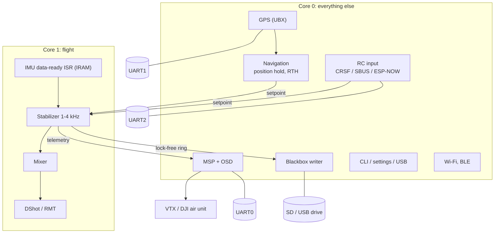

# ESP32-S3 roadmap

**Goal:** run this firmware on an ESP32-S3 and treat it like an STM32 flight controller, with a **camera
overlay (OSD)**, a **GPS** and an **external video transmitter** such as a DJI air unit.

This is a proposal. Nothing here has been built or measured on an S3, and peripheral facts are from the
Espressif datasheet and should be checked against the current one.

## In short

* The S3 is a good flight-controller chip. Dual 240 MHz cores with a single-precision FPU, more RAM and more
  peripherals than the classic ESP32, and a **native USB port** that gives debugging, a console and
  USB-drive access to an SD card without extra parts.
* What is missing is **software and board design, not silicon**: an ESP-IDF 5 port, a hardware abstraction,
  RC and serial protocols (CRSF, SBUS, MSP), GPS, a blackbox and a settings store.
* **The flight controller does not handle video.** With a DJI, HDZero or Walksnail system the camera plugs
  into the air unit and the FC only sends it OSD text over a serial port (MSP DisplayPort). Keep it that
  way. If you want your own video over Wi-Fi, put the camera on a **second S3** next to the FC.
* Biggest risk: **timing determinism** next to Wi-Fi, which the STM32 does not have. The fixes are known and
  are the same dual-core and interrupt work already on the [code review](code-review.md#dual-core-and-timing)
  list.

## STM32 flight controller versus ESP32-S3

What an F4/F7 gives a Betaflight or Crazyflie style controller, and what the S3 offers instead.

| Area | STM32F4 class | ESP32-S3 | Consequence |
|---|---|---|---|
| CPU | Cortex-M4F 168-216 MHz, nested vectored interrupts | 2 x Xtensa LX7 240 MHz, FPU | enough for 1 to 4 kHz loops with the Kalman or Mahony filter |
| Latency and jitter | deterministic, tiny ISR latency | cache and flash arbitration, Wi-Fi/BLE interrupts, flash writes stall the cache | pin flight tasks to one core, put ISRs and hot code in IRAM, no flash writes in flight |
| Interrupts | priority 0-15 in hardware | levels 1 to 3 for C handlers, 4 and up need assembly | a data-ready ISR at level 1-3 in IRAM is fine, keep it short |
| RAM | 192 KB with core-coupled memory | 512 KB, optional PSRAM | more room, but keep flight data in internal RAM, PSRAM is slow and shared |
| Timers and DShot | timer + DMA, bidirectional DShot | RMT (4 TX, 4 RX channels) | DShot out works, bidirectional DShot needs an RMT RX channel per motor |
| UARTs | 5 to 8 | 3 (UART0 is free if the console moves to USB) | receiver, GPS and VTX/OSD fit exactly, a 4th device needs a bridge |
| SPI / I2C | 3-6 / 3 | 2 usable SPI hosts / 2 I2C | IMU on one SPI, SD card or OSD chip on the other |
| USB | OTG FS, CDC and MSC | OTG FS and a built-in USB Serial/JTAG | console, CLI and **USB drive for the blackbox** with TinyUSB |
| SD card | SDIO or SPI | SDMMC host with **any pins**, or SPI | a blackbox is easy |
| Wireless | none | Wi-Fi 4 and BLE 5 on one 2.4 GHz radio | ESP-NOW and phone link for free, but also the interference and timing risk above |
| Camera | none | LCD_CAM peripheral with an 8/16-bit parallel camera port, PSRAM | possible, see below, but not on the FC |
| ADC | 12-bit with DMA | 12-bit, noisy, no DMA in the simple driver | battery voltage is fine, current needs filtering |
| Debug | SWD | USB-JTAG on GPIO19/20, no extra probe | SystemView and gdb over USB |

## The three things you want

### 1. Camera overlay (OSD)

Three ways, only the first belongs on the flight controller.

| Option | How | Verdict |
|---|---|---|
| **A. The VTX draws it** (DJI, HDZero, Walksnail, analog) | The FC sends **MSP DisplayPort** commands (a character canvas) over a UART, about 115200 baud. The air unit renders them on the video. For an analog VTX, an **OSD chip such as the MAX7456 on SPI** draws the text instead. | **Recommended.** No video touches the FC. The work is a character renderer and the MSP encoder. |
| **B. Companion S3 with a camera** | A second S3 reads an OV2640/OV5640 through LCD_CAM into PSRAM, draws the OSD itself and streams MJPEG over Wi-Fi. The FC sends it telemetry over UART or ESP-NOW. | Good for a low-cost Wi-Fi FPV. Keeps the flight core clean. Limited to a few hundred metres and the Wi-Fi frame rate. |
| **C. Camera and video on the FC S3** | Same as B on the flight chip | **Not recommended.** The camera DMA, PSRAM traffic and Wi-Fi stream compete with the control loop for the same buses and the same radio. |

What the FC has to provide for A:

* An **MSP** encoder and decoder (v1 and v2), with the DisplayPort sub-commands the VTX expects, and the
  telemetry commands used to fill the OSD (status, attitude, battery, GPS, altitude).
* An **OSD element model**: which values, at which grid positions, refreshed when. The canvas size differs
  per system (analog 30x16, DJI and HD systems larger), take it from the system's documentation.
* A user-facing way to lay it out (config tool or the schema in [Configuration](configuration.md)).

### 2. GPS

A u-blox style module on a UART. What is missing:

| Piece | Notes |
|---|---|
| **GNSS driver** | UBX binary (NAV-PVT at 5-10 Hz) is better than NMEA: fewer bytes, a time stamp, accuracy and fix fields. Needs configuration at start-up (baud, rate, message set). |
| **Estimator input** | The Kalman filter already has `estimatorKalmanEnqueuePosition`. It needs a local frame (lat/lon to NED around a home point), covariance from the receiver's accuracy fields, and the **Kalman task started**. The barometer driver is a stub. |
| **Magnetometer** | Heading needs a calibrated compass, magnetic declination and interference rejection from the motors. The BMM350 option in [hardware](hardware.md#imu-and-magnetometer) helps. |
| **Modes** | Position hold, return to home, and a GPS-loss failsafe. These are new states in the commander, with sanity checks (satellites, HDOP, fix age). |
| **Home point** | Recorded at arming only with a good fix. |
| **Safety** | Never let a lost fix command motion. Fall back to attitude mode and tell the pilot. |

### 3. External video transmitter, DJI style

| Link | What it is | Notes |
|---|---|---|
| **OSD, MSP DisplayPort** | UART, about 115200 baud | see above, DJI O3, Vista and similar read the FC's MSP stream |
| **VTX control** | analog VTXs use **SmartAudio** or **IRC Tramp** (single-wire half-duplex serial). DJI systems are controlled from their own menu or goggles. | half-duplex needs the UART's RS-485 mode or a loop-back pin |
| **Power** | the air unit draws several amps from the battery, with noise | separate regulator, ferrite, keep it away from the IMU and the compass |
| **RF** | 5.8 GHz video, 2.4 GHz Wi-Fi on the S3, and 2.4 GHz **ELRS** if used | place antennas apart. Wi-Fi next to a 2.4 GHz ELRS receiver costs range on both. |

A DJI system **does not** want video from the FC and sends nothing back except optional goggle-side button
presses (also over MSP). Check the current protocol notes of the exact unit, they change between firmware
versions.

## What is missing, in one table

| Capability | State today | Needed | Effort |
|---|---|---|---|
| ESP-IDF | 4.4.8, S3 only as a preview there | **port to ESP-IDF 5.x**: RMT, ADC, I2C and GPIO drivers changed, `esp_now` already handled | L |
| Hardware abstraction | drivers call ESP-IDF directly | thin `hal_uart / spi / i2c / motor / time` so S3 specifics stay in one place | M |
| RC receiver input | ESP-NOW and UDP only | **CRSF (ELRS, Crossfire) and SBUS** on a UART, with link statistics | M |
| Serial protocol stack | CRTP only | **MSP v1/v2** (OSD, telemetry, configuration), CRSF telemetry | M-L |
| OSD | none | element model, MSP DisplayPort, optional MAX7456 | M-L |
| GPS | none | UBX driver, local frame, Kalman fusion, modes | L |
| Magnetometer | QMC5883L, bug fixed, not validated | proper alignment and calibration | M |
| Barometer | stub | driver and fusion | M |
| Blackbox | none | ring buffer, SD writer, USB drive | M-L |
| Settings | Kconfig only, parameters lost at reboot | NVS store and a CLI | M |
| Timing | software-timer tick, no pinning | interrupt-driven tick, core pinning, IRAM | M |
| Safety net | keepalive only | task watchdog, DShot disarm, battery actions, GPS-loss failsafe | M |
| Tests | one host test | a host suite for protocols and control code | M |
| Debug | external JTAG for SystemView | USB-JTAG | S |

## Target architecture

Rules that make it work:

1. **Flight core stays closed.** Only the stabilizer, the IMU read and the motor output run on core 1.
   Everything that waits on a radio, a card or a human runs on core 0.
2. **Cores talk through lock-free buffers**, never through a mutex the flight task can block on.
3. **Setpoint sources are equal**: RC, navigation and the ESP-NOW link all end in the commander, which
   keeps the watchdogs and the arming rules from the [architecture](architecture.md#safety-model).
4. **Flight data in internal RAM and IRAM**. Flash writes (settings) only while disarmed.

## Phases

| Phase | Content | Done when |
|---|---|---|
| **0. Preparation** (on the current ESP32) | the on-hold timing work, host tests, persistent settings, the HAL boundary | the stabilizer period jitter is measured and small, tests run in CI |
| **1. ESP-IDF 5.x port** | RMT, ADC, I2C, GPIO drivers, FreeRTOS naming, partition table | the same firmware builds and flies on the ESP32 under IDF 5.x |
| **2. S3 bring-up** | pin map, USB-JTAG and console, DShot over the new RMT driver, IMU interrupt, core pinning | the ESP32-S3 flies the current feature set on the bench and in hover |
| **3. FC baseline** | CRSF/SBUS input, MSP, **OSD for the VTX**, SD blackbox and USB drive, CLI and NVS settings | you can fly with ELRS, see an OSD in the goggles and read the log from a PC |
| **4. Navigation** | GPS driver, magnetometer calibration, Kalman fusion, position hold, home and return, GPS failsafes | position hold works outdoors, with a tested fallback when the fix is lost |
| **5. Video** (optional) | a companion S3 with a camera and an overlay over Wi-Fi, or evaluate the ESP32-P4 | as needed |

## Board design notes for the S3

| Topic | Note |
|---|---|
| Pins | 45 GPIO. GPIO26 to 32 are the SPI flash, GPIO33 to 37 are also taken with octal PSRAM, GPIO19/20 are USB. A flight controller needs about 30, which fits. |
| Strapping | GPIO0, 3, 45, 46 decide boot behaviour, avoid them for anything that is driven at reset |
| UARTs | UART0 receiver or MSP, UART1 GPS, UART2 VTX/OSD. Console on USB. |
| Power | Wi-Fi transmit bursts reach a few hundred milliamps. Give the S3 a clean 3.3 V rail with enough bulk capacitance, keep ESC and VTX noise out of it. |
| Antennas | S3 antenna away from the ELRS and the VTX antennas |
| IMU | on its own SPI host, with its interrupt on a pin with no other use |
| Module | WROOM-1 without PSRAM for the FC. PSRAM only on a companion board. |

## Alternatives

| Option | When |
|---|---|
| **Stay on the classic ESP32 for the FC**, add an S3 companion for camera and OSD | the least risky path, the FC needs only the UART and timing work |
| **ESP32-P4** (RISC-V, up to 400 MHz, hardware H.264 encoder, MIPI camera) with an ESP32-C6 for Wi-Fi | if you want video and the flight loop on one chip. It needs ESP-IDF 5.3 or newer and the ecosystem is young, check its current status. |
| A **dedicated STM32 FC** with the ESP32 as a wireless link | if you need a mature flight stack now. This repository's firmware then becomes the link and telemetry bridge. |

## Open questions

1. Which VTX system, and which receiver protocol (ELRS or Crossfire over CRSF, or SBUS)?
2. Is the 2.4 GHz Wi-Fi control link still wanted next to a 2.4 GHz ELRS receiver?
3. How much range and video quality do you expect, and is a Wi-Fi video link good enough?
4. Does the IMU and compass choice (BMI270 + BMM350) stay for the S3 board?
5. OTA updates: they decide the flash size and the partition layout.
