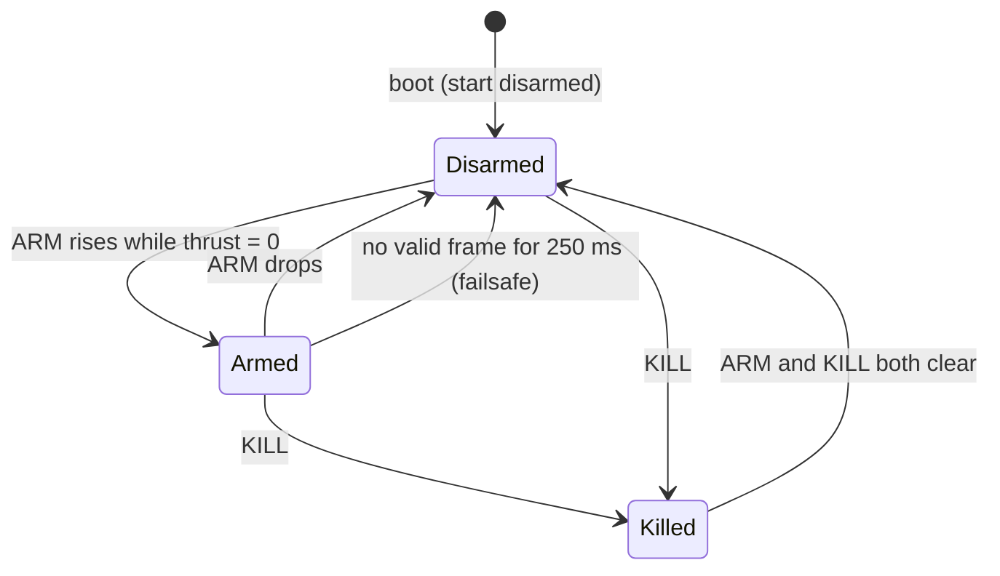

# ESP-NOW control link

A transmitter sends small control frames to the drone over ESP-NOW, the drone answers with status frames.
No pairing handshake, no router, one hop.

* Implementation: [`espnow_link.c`](../../components/core/crazyflie/hal/src/espnow_link.c)
* Wire format (shared with the transmitter): [`espnow_link.h`](../../components/core/crazyflie/hal/interface/espnow_link.h)
* Reference transmitter: [`examples/espnow_transmitter`](../../examples/espnow_transmitter)
* Unit test: [`tests/host/test_espnow_link.c`](../../tests/host/test_espnow_link.c)

## Radio setup

| Item | Value |
|---|---|
| Channel | the drone's Wi-Fi channel, `WIFI_CHANNEL` (default 6). ESP-NOW rides on the soft-AP channel, the transmitter must use the same one. |
| Frames to the drone | unicast to the drone's **AP MAC** (the six bytes at the end of the SSID `ESP-DRONE_<MAC>`), or broadcast. Encryption needs unicast. |
| Which transmitter is accepted | the **STA MAC** set in `ESPNOW_CTRL_PEER_MAC`. Empty means any transmitter, for the bench only (the drone logs a warning). |
| Frames to the transmitter | status frames, sent from the drone's AP MAC to the last valid sender |
| Rate | 100 Hz recommended (10 ms). The failsafe timeout of 250 ms then tolerates about 25 lost frames. |

## Frames

All fields little endian, packed. The CRC is **CRC-16/CCITT-FALSE** (polynomial `0x1021`, init `0xFFFF`)
over every byte before the `crc` field.

### Control, transmitter to drone (16 bytes)

| Offset | Size | Field | Meaning |
|---|---|---|---|
| 0 | 1 | `magic` | `0xD7` |
| 1 | 1 | `version` | `1` |
| 2 | 1 | `type` | `1` |
| 3 | 1 | `flags` | bit 0 `ARM`, bit 1 `KILL` |
| 4 | 2 | `seq` | +1 per frame, wraps |
| 6 | 2 | `roll` | -1000..1000, positive = right |
| 8 | 2 | `pitch` | -1000..1000, positive = forward |
| 10 | 2 | `yaw` | -1000..1000, positive = clockwise rate |
| 12 | 2 | `thrust` | 0..1000 |
| 14 | 2 | `crc` | |

Signs follow cflib `send_setpoint()`. Stick positions are scaled by the drone:

| Field | Full scale | Setting |
|---|---|---|
| roll, pitch | 15 degrees | `ESPNOW_CTRL_MAX_ANGLE_DEG` |
| yaw | 30 deg/s | `ESPNOW_CTRL_MAX_YAW_RATE_DPS` |
| thrust | 300 (about 12 % throttle) | `ESPNOW_CTRL_THRUST_MAX`, never above `MOTOR_THRUST_MAX` |

Values outside the range are clamped.

### Status, drone to transmitter (10 bytes)

| Offset | Size | Field | Meaning |
|---|---|---|---|
| 0 | 1 | `magic` | `0xD7` |
| 1 | 1 | `version` | `1` |
| 2 | 1 | `type` | `2` |
| 3 | 1 | `flags` | bit 0 armed, bit 1 killed, bit 2 battery low, bit 3 failsafe |
| 4 | 2 | `seqAck` | `seq` of the last control frame that was applied |
| 6 | 2 | `batteryMv` | pack voltage in mV |
| 8 | 2 | `crc` | |

Sent every `ESPNOW_CTRL_STATUS_PERIOD_MS` (100 ms) while the link is up.

## Arming, kill and failsafe



| Rule | Detail |
|---|---|
| **Arm on an edge** | ARM must go from 0 to 1 while `thrust` is 0. If thrust is not zero, arming is refused and logged. |
| **No inherited arm** | When the link comes up (first frame, or the first frame after a failsafe) and ARM is already set, the drone stays disarmed until ARM is dropped and raised again. |
| **Disarmed means zero thrust** | While disarmed the thrust sent to the commander is forced to 0, roll and pitch are still passed on. |
| **Kill** | Stops the motors at once, disarms, and **latches**. It is released only by a frame with ARM and KILL both clear, then arming needs a fresh edge. |
| **Stops that are not ours** | A stop set by tumble detection is never released by the link. |
| **Failsafe** | Without a valid frame for `ESPNOW_CTRL_LINK_TIMEOUT_MS` the drone sets level attitude and zero thrust and, if `ESPNOW_CTRL_FAILSAFE_DISARM` is on, disarms. The status shows `FAILSAFE` until frames return. |
| **Stale and repeated frames** | A frame older than the timeout when it is picked up, or with a sequence number not newer than the last one (wrap safe), is dropped. After a failsafe the sequence restarts. A transmitter that reboots is therefore ignored until the 250 ms timeout expires, then it re-synchronises. |
| **Boot** | Disarmed, if `ESPNOW_CTRL_START_DISARMED` is on (default). cfclient can still arm with the `system.forceArm` parameter. |

## Security

| Layer | Protects against | Setting |
|---|---|---|
| CRC-16 | corrupted frames | always |
| Magic, version, length | foreign or malformed frames | always |
| MAC allowlist | other transmitters on the channel | `ESPNOW_CTRL_PEER_MAC` |
| ESP-NOW encryption (CCMP) | spoofed MAC, eavesdropping | `ESPNOW_CTRL_ENCRYPT` + 16-character `PMK` and `LMK`, needs a peer MAC and unicast |

The sequence number and CRC are **not authentication**: anyone can build a valid frame. Use the MAC
allowlist at least, and encryption for anything beyond the bench. There are no default keys, the link
refuses to start with encryption on and no keys.

## Settings

| Symbol | Default | Range |
|---|---|---|
| `ESPNOW_CTRL_ENABLE` | on | |
| `ESPNOW_CTRL_PEER_MAC` | empty (accept any) | `aa:bb:cc:dd:ee:ff` |
| `ESPNOW_CTRL_ENCRYPT`, `_PMK`, `_LMK` | off | keys are 16 characters |
| `ESPNOW_CTRL_LINK_TIMEOUT_MS` | 250 | 50 to 2000 |
| `ESPNOW_CTRL_FAILSAFE_DISARM` | on | |
| `ESPNOW_CTRL_START_DISARMED` | on | |
| `ESPNOW_CTRL_STATUS_PERIOD_MS` | 100 | 20 to 1000 |
| `ESPNOW_CTRL_MAX_ANGLE_DEG` | 15 | 1 to 45 |
| `ESPNOW_CTRL_MAX_YAW_RATE_DPS` | 30 | 1 to 360 |
| `ESPNOW_CTRL_THRUST_MAX` | 300 | 48 to 2047 |

## Writing a transmitter

The reference project sends a frame every 10 ms, prints the drone's status once a second, and arms after
3 seconds with **thrust held at zero**, so it is safe with the props off.

```bash
cd examples/espnow_transmitter
idf.py set-target esp32
idf.py build flash monitor
```

Before flashing, edit `DRONE_AP_MAC` and `LINK_CHANNEL` at the top of `main/main.c`. After the first boot,
copy the STA MAC the transmitter prints into the drone's `ESPNOW_CTRL_PEER_MAC`. Replace `readInputs()` with
your sticks. The only thing a transmitter must do is fill `espnowLinkControl_t`, compute the
CRC with `espnowLinkCrc16()` and call `esp_now_send()`. Define `ESPNOW_LINK_TRANSMITTER_BUILD` before
including the header so only the wire format is pulled in.

### Phone as a joypad

A phone cannot send ESP-NOW. Put an ESP32 between them: the phone talks to the bridge over BLE or
Wi-Fi/UDP, the bridge runs the transmitter code. Two rules for the bridge:

* It owns the **link to the drone**, so if the phone link drops it must stop sending (the drone's failsafe
  then takes over) or send `KILL`, never repeat the last stick values.
* Arming should be a deliberate, separate action in the app, sent as the ARM flag with thrust at zero.

## What is verified

| | |
|---|---|
| Builds on ESP-IDF 4.4.8, transmitter example builds | yes |
| Host unit test (arming edge, thrust rule, scaling, kill latch, foreign stop, failsafe, validation, MAC check) | yes, passes with AddressSanitizer and UBSan |
| The task loop: sequence and staleness rejection, "link comes up with ARM set", status scheduling | **not covered by the unit test** |
| Over the air: range, latency, loss, encryption interoperability | **not verified on hardware** |
| RSSI | not available, the ESP-IDF 4.4 receive callback does not provide it |

The ESP-NOW link and the Wi-Fi soft AP share one radio and one channel. A dashboard connected to the AP
costs airtime on the control link, keep that in mind when you stream logs in flight.
