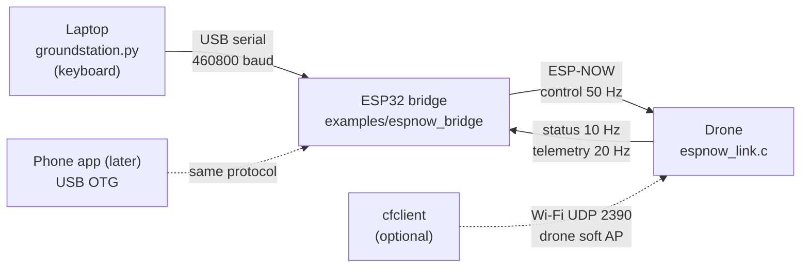

# Ground station

Fly the drone from a laptop today, and from a phone app later, over the [ESP-NOW link](espnow-link.md).
A phone or a laptop cannot send ESP-NOW, so an ESP32 on a USB cable does it for them.



Nothing here has flown yet. The bridge and the tool have been tested against a simulator
(`sim_bridge.py`), the drone side with the host unit test. **Props off** until the bench checks below pass.

## What you need

| Item | Notes |
|---|---|
| The drone, flashed with this firmware | V1.0 board, battery or bench supply. Use the bench profile for the first tests. |
| **Any ESP32 development board** for the bridge | ESP32-DevKitC, NodeMCU-32S and the like, with a USB-UART chip (CP2102, CH340). An ESP32-S3 or C3 board works too: on a native-USB port set the console to USB-Serial-JTAG before building the bridge. |
| USB cable | the data kind |
| Laptop with Python 3 | `pip install -r tools/groundstation/requirements.txt` (pyserial, pygame) |
| ESP-IDF 4.4.8 | `tools/setup-idf.sh`, already used for the drone |

## Step by step

**1. Flash the drone** with the bench layer (thrust ceiling 300, boots disarmed, failsafe disarms):

```bash
idf.py set-target esp32
idf.py -D "SDKCONFIG_DEFAULTS=sdkconfig.defaults;profiles/bench.defaults" reconfigure build flash monitor
```

Note the drone's **AP MAC**: it is the end of the Wi-Fi network name `ESP-DRONE_xxxxxxxxxxxx`, or run
`idf.py monitor` and read the Wi-Fi start-up lines. Also note `WIFI_CHANNEL` (default 6).

**2. Flash the bridge** (a second ESP32, on its own USB port):

```bash
cd examples/espnow_bridge
idf.py set-target esp32
idf.py -p /dev/ttyUSB1 build flash
```

**3. Pair the bridge with the drone**, from the repository root:

```bash
pip install -r tools/groundstation/requirements.txt
python3 tools/groundstation/groundstation.py info   --port /dev/ttyUSB1
python3 tools/groundstation/groundstation.py config --port /dev/ttyUSB1 --drone-mac <drone AP MAC> --channel 6 --save
```

Opening the serial port can reset a board with an auto-reset circuit (most CP2102 and CH340 boards), so the
tool waits for the bridge's first reply before it sends anything. A saved pairing survives that reboot.

`info` prints the bridge's **STA MAC**. Put it into the drone as `ESPNOW_CTRL_PEER_MAC` (menuconfig: ESPDrone
Config, Receiver & Link, ESP-NOW control link) and flash the drone again, so that only your bridge is
obeyed. For the very first bench test an empty value works too (any transmitter accepted, the drone logs a
warning).

**4. Fly from the keyboard**, props off:

```bash
python3 tools/groundstation/groundstation.py fly --port /dev/ttyUSB1
```

| Key | Action |
|---|---|
| Space | arm / disarm. Arming is refused unless thrust is 0. |
| Up / Down | thrust up / down; it stays where you leave it |
| 0 or X | thrust to zero |
| W / S, A / D, Q / E | pitch, roll, yaw while held, at `--stick` percent (default 50); Shift for full |
| K or Esc | KILL: motors stop, latched |
| R | release the kill (then arm again with Space) |

Closing the window, or the window losing focus, sets thrust 0 and disarms; on exit the tool sends a
short KILL burst. The window shows the drone's state, battery, attitude, gyro, mixer output and the bridge
counters.

`monitor` prints the same data without sending anything. It only shows frames while something else keeps
the link up.

## Bench checks before the props go on

These match the P0 list in the [code review](code-review.md#safety).

| Check | How | Expected |
|---|---|---|
| Arming rule | Up to some thrust, then Space | "arming refused" |
| Arm, motors spin | thrust 0, Space, then a little Up | motors 1-4 follow, telemetry shows the mixer values |
| Direction | W, A, Q one at a time | the right motors speed up (front/back, left/right, diagonals for yaw) |
| Kill | K while spinning | motors stop at once, status KILLED, R then Space needed to arm again |
| Link loss | pull the bridge's USB cable while spinning | within 250 ms the drone levels, cuts thrust and disarms (status FAILSAFE) |
| Laptop stops | close the window while spinning | disarm, then KILL |
| Range | walk away with the laptop | note where status frames start to drop |
| Battery | compare the displayed voltage with a meter | within a few percent |

If a motor runs the wrong way, or the mixer moves the wrong motors, fix that before anything else.

## Real-time data

| Frame | Direction | Rate | Content |
|---|---|---|---|
| CONTROL | laptop to drone | 50 Hz from `groundstation.py` | sticks, ARM, KILL |
| STATUS | drone to laptop | 10 Hz (`ESPNOW_CTRL_STATUS_PERIOD_MS`) | armed, killed, battery low, failsafe, battery voltage, last acked control frame |
| TELEMETRY | drone to laptop | 20 Hz (`ESPNOW_CTRL_TELEMETRY_PERIOD_MS`, 0 = off) | attitude, gyro rates, thrust, motor outputs, battery |
| BRIDGE_INFO | bridge to laptop | 2 Hz | bridge MAC, target drone, channel, counters |

Frame layouts are in [espnow-link.md](espnow-link.md#frames) and
[`bridge_protocol.h`](../../examples/espnow_bridge/main/bridge_protocol.h); the Python version is
[`espdrone_link.py`](../../tools/groundstation/espdrone_link.py). More data per frame is cheap (an ESP-NOW frame
carries up to 250 bytes), but every frame costs airtime on the channel the control link uses.

### cfclient

The esp-drone client ([qljz1993/crazyflie-clients-python](https://github.com/qljz1993/crazyflie-clients-python),
with the [leeebo cflib fork](https://github.com/leeebo/crazyflie-lib-python)) does **not** use ESP-NOW. Its
`udpdriver.py` joins the drone's Wi-Fi access point and sends CRTP packets with a one-byte checksum to UDP
port 2390 (`udp://192.168.43.42:2390`); the drone's `wifilink` answers. That path still works and is the
way to reach the CRTP log, parameters and the plotter. It can run next to the ESP-NOW link, but both share one
radio and one channel, so stream logs sparingly while flying. cflib's serial driver speaks CPX, the AI-deck
protocol, and is not a fit for the bridge.

## Towards the phone app

A first draft of the Android app is in [`android-app/`](../../android-app) (never built yet, see its README).

The bridge protocol is the app's protocol: the app replaces `groundstation.py` and sends the same frames.

| Topic | Plan |
|---|---|
| Phone to bridge | **USB OTG** first: Android talks to CP210x, CH34x and the ESP32-S3's native USB with the open-source usb-serial-for-android library, no bridge change. BLE later means a GATT service in the bridge with the same frames. |
| Code to port | `espdrone_link.py`: CRC, frame building, the resynchronising parser. About 150 lines of Kotlin. |
| Sticks | two on-screen joysticks map to roll/pitch and yaw/thrust, -1000..1000 and 0..1000 |
| Rate | 50 Hz, from a timer, not from touch events |
| Safety | the app must stop sending when it goes to the background or the screen locks (the drone's failsafe then acts), and arming must be a separate, deliberate control |
| Video | on the second phone, from the video system; the control phone only shows the telemetry |
| Testing | `sim_bridge.py` makes a pseudo terminal; a USB-serial adapter to the laptop running it lets the app be tested without the drone |

## Files

| File | What it is |
|---|---|
| [`examples/espnow_bridge`](../../examples/espnow_bridge) | bridge firmware |
| [`tools/groundstation/groundstation.py`](../../tools/groundstation/groundstation.py) | `info`, `config`, `monitor`, `fly` |
| [`tools/groundstation/espdrone_link.py`](../../tools/groundstation/espdrone_link.py) | the protocol in Python, no dependencies |
| [`tools/groundstation/sim_bridge.py`](../../tools/groundstation/sim_bridge.py) | bridge and drone simulator on a pseudo terminal |
| [`tools/groundstation/test_espdrone_link.py`](../../tools/groundstation/test_espdrone_link.py) | unit tests: `python3 -m unittest tools/groundstation/test_espdrone_link.py` |
