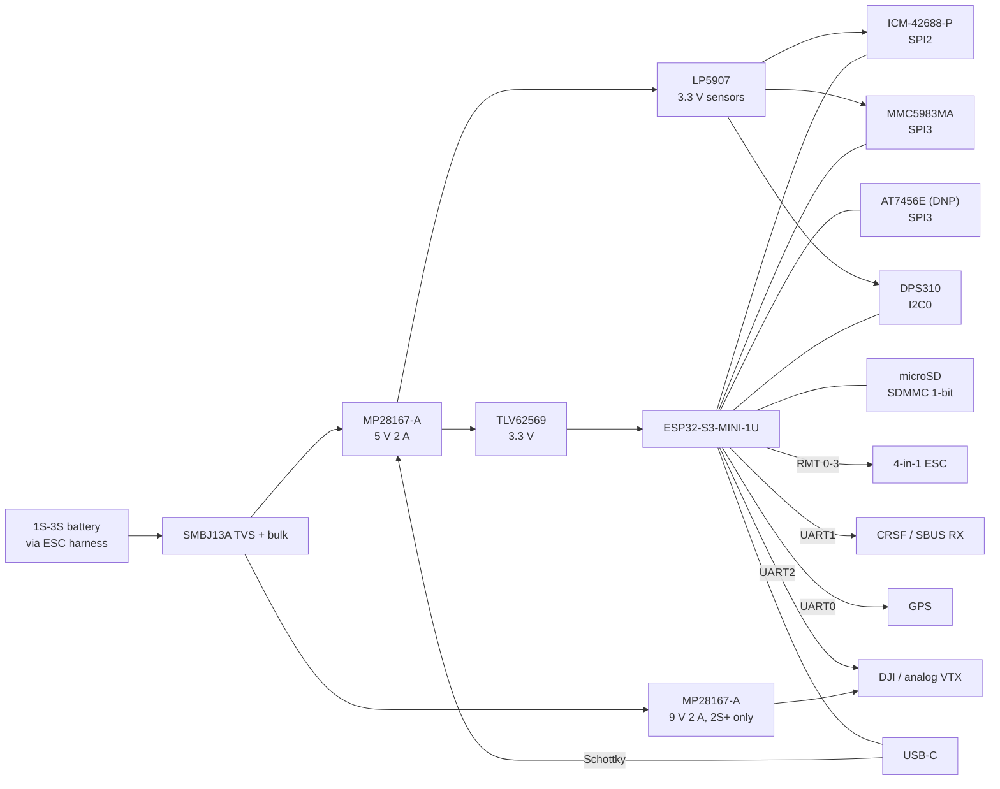

# FlyingFree V2 (FF02): PCB plan

The ESP32-S3 successor of the FlyingFree V1.0, specified in the
[board requirements](../../docs/handbook/esp32-s3-board-requirements.md). This folder holds the design
until it is entered into a PCB tool. No CAD tool is needed for anything here: the schematic is drawn as
SVG from one Python description, which also produces the bill of materials and the netlist.

**State: draft A, 2026-10-23.** Functional schematic, placement study and first datasheet review done.
Nothing has been built.

## Files

| File | What it is |
|---|---|
| [`schematic/gen_schematic.py`](schematic/gen_schematic.py) | the board description (parts, pins, nets) and the generator. **Edit this, not the outputs.** |
| `schematic/sheet-01...06-*.svg` | six schematic sheets: power (2), MCU, sensors and storage, connectors, video |
| [`bom.csv`](bom.csv) | bill of materials, generated |
| [`netlist.csv`](netlist.csv) | every net and the pins on it, generated. Used to check the CAD schematic later. |
| [`schematic/gen_floorplan.py`](schematic/gen_floorplan.py), `schematic/floorplan.svg` | placement study, top and bottom, with the distance checks |
| [`datasheets.md`](datasheets.md) | datasheet links per part, the facts checked in them, and what changed because of them |

Regenerate after a change, with the standard library only:

```sh
python3 hardware/flyingfree-v2/schematic/gen_schematic.py   # fails if a net has one connection
python3 hardware/flyingfree-v2/schematic/gen_floorplan.py   # fails on overlaps or keep-out hits
```

The schematic shows pin functions (VIN, SCLK, INT1) with the package pin number where it was checked in
the datasheet ("IN 1"). Nets with the same label are connected.

## Block diagram



## Pin map

All 39 GPIO of the ESP32-S3-MINI-1U-N8 are used ([requirements, GPIO budget](../../docs/handbook/esp32-s3-board-requirements.md#gpio-budget)).
This table is the source for the FF02 Kconfig defaults in the [firmware plan](../../docs/handbook/firmware-dual-target.md#board-abstraction).

| GPIO | Net | Function | Notes |
|---|---|---|---|
| 0 | BOOT | boot button | strapping |
| 1 | VBAT_ADC | battery voltage | ADC1 CH0, divider 56 k / 10 k |
| 2 | CURR_ADC | ESC current | ADC1 CH1, clamped |
| 3 | BUZZER | buzzer MOSFET gate | strapping, 100 k pull-down |
| 4-6 | SPI3_SCK, SPI3_MOSI, SPI3_MISO | SPI3 | magnetometer and OSD |
| 7 | MAG_CS | magnetometer CS | 10 k pull-up |
| 8 | UART2_RX | VTX / DJI RX | |
| 9 | IMU_INT1 | IMU data ready | GPIO ISR, used for nothing else |
| 10-13 | IMU_CS, IMU_MOSI, IMU_SCK, IMU_MISO | SPI2 (FSPI IOMUX pins) | IMU only |
| 14 | IMU_INT2 | IMU INT2 / 32 kHz CLKIN | LEDC output for CLKIN |
| 15 | PINIO2 | spare switched output | glitches at power-up |
| 16 | LED_STRIP_IO | WS2812 data | I2S, through a 5 V buffer |
| 17, 18 | UART1_TX, UART1_RX | receiver (CRSF, SBUS) | inversion in the UART |
| 19, 20 | USB_DN, USB_DP | native USB | fixed |
| 21 | VTX_EN_N | 9 V rail enable, low = on | no glitch, pull-up, off at reset |
| 26 | UART2_TX | VTX / DJI TX, SmartAudio | |
| 33-36 | M1_IO-M4_IO | DShot motors 1-4 | RMT TX 0-3, no glitch, 100 R series |
| 37, 38 | M5_IO, M6_IO | servo / PWM outputs | MCPWM or LEDC, no glitch |
| 39 | OSD_CS | OSD CS | 10 k pull-up |
| 40-42 | SD_CLK, SD_CMD, SD_D0 | SDMMC 1-bit | 10 k pull-ups on CMD and D0-D3 |
| 43, 44 | UART0_TX, UART0_RX | GPS | ROM boot log on TX |
| 45, 46 | LED_R, LED_G | status LEDs | strapping, LEDs keep them low |
| 47, 48 | I2C0_SDA, I2C0_SCL | barometer, external compass pads, EEPROM | 2.2 k pull-ups |

**Why the motors are on 33-38:** the chip datasheet (table 2-2) lists a low glitch of about 60 us at
power-up on GPIO1-18, and longer ones on 19 and 20. Only 0, 21, 26 and 33-48 are quiet. Motor, servo and
the 9 V enable must not pulse at reset (MOT-02), so they use quiet pins. Buses, chip selects and the buzzer
can take a 60 us glitch before the firmware starts.

Confirmed in the module datasheet: GPIO26 and 33-37 are usable on the N8 (quad flash, no PSRAM). Its note
"for pins 28-29, 31-33 the default function is decided by eFuse" concerns IO33-37: check on the first board
that they come up as inputs (scope on M1-M5 at power-up). If not, M1-M5 move to 39-42 and 47, and the SD
card and I2C take the freed pins.

## Placement study

[`schematic/floorplan.svg`](schematic/floorplan.svg), from typical package sizes:

| Check | Result | Requirement |
|---|---|---|
| IMU centre from the board centre | 1.0 mm | MEC-06: at most 5 mm |
| Magnetometer to the nearest inductor (L3) | 17.3 mm | SEN-04: at least 15 mm |
| IMU to the nearest inductor | 10.2 mm, tight | EMC-02: at least 10 mm |
| Barometer to the nearest inductor | 16.8 mm | EMC-02: at least 10 mm |
| OSD clock to the IMU | 9.3 mm | keep the 27 MHz loop small |
| Area used, top / bottom | 597 / 564 of 1163 mm2 | routing room remains on both sides |

Sizes from the datasheets where known (module 15.4 x 15.4 mm, inductors 5 x 5 mm for saturation margin),
typical package sizes elsewhere.

The arrangement that makes it work:

* **Top:** the module along the top edge (U.FL at the edge); the IMU just below it in the centre; the two
  buck-boosts and their inductors in a strip along the bottom edge; the magnetometer and barometer in the
  two upper side zones; the OSD chip (HTSSOP with an exposed pad, so a hot-plate part) on the right.
* **Bottom:** the microSD slot under the module; the ESC connector under the power strip (short VBAT path);
  the DJI connector, BOOT button, EEPROM and pads.

The bottom side holds only parts an iron can solder (ASM-03).

## Phases

| # | Phase | Work | Done when |
|---|---|---|---|
| 0 | Requirements | [requirements](../../docs/handbook/esp32-s3-board-requirements.md) and the decisions | done 2026-10-23 |
| 1 | **Datasheets and part check** | collect every datasheet ([datasheets.md](datasheets.md)), close the "to verify" list, confirm stock and second sources, freeze the BOM | every BOM line has a checked datasheet and two distributors with stock |
| 2 | **Schematic** | complete pin lists from the datasheets, compute every divider (FB, EN, ISET, current limit), application-circuit passives, regenerate, review with the checklist below | review passed, `gen_schematic.py` reports no problems |
| 3 | **Footprints and placement** | footprints from the datasheets' land patterns; update `gen_floorplan.py` with real sizes; stack height check (MEC-03) | the placement study passes with real courtyards |
| 4 | **CAD entry and layout** | enter the netlist into a PCB tool (KiCad suggested, free and in line with the project's GPL), compare its netlist with `netlist.csv`, then route: 4 layers, power strip first, then the SPI buses and USB | DRC clean, netlist identical, layout review passed |
| 5 | **Fabrication** | gerbers, drill, pick list, stencil; order 5 boards and a stencil | boards and stencil received |
| 6 | **Assembly** | top: paste, place, hot plate; bottom: iron; one board at a time, power first | see the assembly procedure below |
| 7 | **Bring-up** | [verification table](../../docs/handbook/esp32-s3-board-requirements.md#verification-at-bring-up); firmware step 3 of the [firmware plan](../../docs/handbook/firmware-dual-target.md#order-of-work) | the board hovers |
| 8 | **Revision B** | collect the faults, fix, reorder | |

Phases 1 to 5 run in parallel with firmware steps 1 and 2 (board abstraction and the ESP-IDF 5.x port on
the current board).

## Schematic review checklist

| Area | Check |
|---|---|
| Power | input range of every part on VBAT above 13.2 V plus spikes; TVS clamp below the lowest absolute maximum |
| | MP28167-A: FB divider, EN divider (2.6 V UVLO for 5 V, 6 V for 9 V), ISET, inductor current rating above the peak at 2.8 V input |
| | USB-only: no path from VBUS into VBAT; the 9 V rail stays off |
| | 3.3 V: 800 mA at 30 mV ripple; 22 uF next to the module |
| Straps | GPIO0, 3, 45, 46 levels at reset with every pull and load attached |
| | motor and servo pins quiet at reset |
| Levels | nothing above 3.3 V on an S3 pin: OSD SDOUT if the OSD runs on 5 V; the buffered LED strip line; UART pads with series resistors |
| Sensors | IMU and magnetometer on the clean 3.3 V; decoupling per datasheet; reserved pins tied as the datasheet says |
| | MMC5983MA interface selection (SPI) and its set/reset capacitor |
| Buses | SPI2 has only the IMU; SPI3 chip selects idle high; I2C pull-ups present once |
| | SD: pull-ups on CMD and D0-D3; card supply capacitor |
| Protection | ESD on USB and the external pads; series resistors on the motor lines |
| Test | test point on every rail; production pads |
| BOM | every part in stock at two distributors; no WLCSP or BGA (ASM-04) |

## Fabrication notes (for phase 5)

| Item | Value | Why |
|---|---|---|
| Layers | 4: signal / GND / power / signal | EMC-01 |
| Thickness | 1.6 mm | MEC-03 |
| Copper | 1 oz outer and inner (2 oz outer if the power strip runs hot) | |
| Finish | **ENIG** | flat pads for the LGA module, IMU and magnetometer |
| Vias | tented, none in pads under LGA parts | ASM-07 |
| Stencil | top only, 0.10-0.12 mm, frameless; reduced apertures on the module ground pads | ASM-01 |
| Silkscreen | pad labels, IMU arrow, board name and revision | TST-02 |

## Assembly procedure (for phase 6)

1. Inspect the bare board. Measure for shorts between VBAT, +5V, +3V3 and GND.
2. **Top side, power only:** paste, place D1, U1, L1, U2, L2, U3 and their passives. Hot plate.
3. Power up from a **current-limited supply** (start at 3.7 V, 100 mA). Check +5V, +3V3 and +3V3_SENS, then
   sweep 2.8 V to 13.2 V. Fit U4 and L3 only after this passes.
4. **Rest of the top side:** paste, place the module, IMU, magnetometer, barometer, ESD and LEDs. Hot plate.
   Inspect the LGA parts from the sides with a loupe; rework with hot air.
5. USB: the board must enumerate (USB-Serial-JTAG). Flash a test firmware that reads every chip ID.
6. **Bottom side with the iron:** connectors, microSD slot, OSD (analog builds), EEPROM if fitted, pads.
7. Run the verification table before connecting an ESC. Then connect the ESC without propellers.

## Risks

| Risk | Effect | Mitigation |
|---|---|---|
| 39 of 39 GPIO used | no room for a fix in revision A | M6 is the reserve (requirements, GPIO budget); test pads on the spare-capable pins |
| LGA module and sensors hand-soldered | opens under the parts, hard to see | ENIG, stencil, hot plate, ID-read test before the bottom side |
| Magnetometer on a board with 2 buck-boosts | heading error under load | shielded inductors, 15 mm spacing, current input for compensation, external compass pads as a fallback |
| MP28167-A at 2.8 V and in USB-only mode | start-up or back-feed problems | bench test in step 3 before the rest is fitted |
| DShot waveform after the IDF 5 port | motors do not arm | scope check on FF01 first (firmware step 2) |
| Betaflight ESP32 code is young | less to borrow than hoped | only protocols and filters are taken, see the firmware plan |
